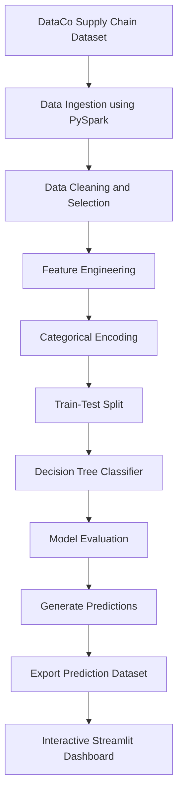

# 📦 E-Commerce Delivery Delay Prediction & Supply Chain Analytics

An end-to-end data engineering and machine learning project that processes supply chain data using **Apache Spark**, predicts delivery delay risk using **Spark MLlib**, and presents actionable insights through an interactive **Streamlit analytics dashboard**.

The project combines large-scale data processing, data preparation, feature engineering, predictive analytics, model evaluation, and business intelligence visualization.

## 🚀 Live Dashboard

**[Explore the Live Streamlit Dashboard](https://ecommerce-delivery-prediction.streamlit.app/)**

*Replace this URL with your actual deployed Streamlit URL after deployment.*

---

## 📌 Project Overview

E-commerce companies depend on timely deliveries to maintain customer satisfaction and operational efficiency. Unexpected delivery delays can affect customer experience, logistics planning, and supply chain performance.

This project analyzes historical supply chain data to identify delivery risk patterns and build a machine learning model that predicts whether an order is likely to experience delivery delay risk.

### Business Objectives

- Analyze historical e-commerce shipping and delivery data.
- Identify patterns in late deliveries across regions and shipping modes.
- Build a scalable data processing workflow using Apache Spark.
- Engineer meaningful features for predictive modeling.
- Train and evaluate a Decision Tree classification model.
- Develop an interactive dashboard for exploring delivery performance.
- Provide data-driven insights to support logistics and operational decision-making.

---

## 🛠️ Tech Stack

| Category | Technologies |
|---|---|
| Programming | Python |
| Big Data Processing | Apache Spark, PySpark |
| Distributed Data Processing | Spark DataFrames |
| Machine Learning | Spark MLlib |
| ML Algorithm | Decision Tree Classifier |
| Data Preparation | Spark SQL, DataFrame transformations |
| Feature Engineering | StringIndexer, OneHotEncoder, VectorAssembler |
| Data Analysis | Pandas |
| Data Visualization | Plotly |
| Dashboard Development | Streamlit |
| Development Environment | VS Code, Jupyter, Terminal |
| Version Control | Git, GitHub |

---

## 📊 Dataset

**DataCo Smart Supply Chain Dataset**

Source: [Kaggle – DataCo Smart Supply Chain for Big Data Analysis](https://www.kaggle.com/datasets/shashwatwork/dataco-smart-supply-chain-for-big-data-analysis)

| Dataset Information | Details |
|---|---|
| Total records | 180,519 |
| Total attributes | 53 |
| Target variable | `Late_delivery_risk` |
| Target classes | 0 – Not late, 1 – Late |
| Data format | CSV |

### Selected Features

| Feature | Description |
|---|---|
| Shipping Mode | Shipping service category |
| Order Region | Geographic order region |
| Order Country | Destination country |
| Market | Market classification |
| Scheduled Shipping Days | Expected shipping duration |
| Order Month | Month extracted from order date |
| Order Weekday | Day of week extracted from order date |

### Target Variable

`Late_delivery_risk`

- **0:** No late-delivery risk
- **1:** Late-delivery risk

Actual delivery duration and delivery status were excluded from the predictive features to avoid using information that would only be available after delivery.

---

## ⚙️ Project Workflow



### 1. Data Ingestion & Processing
- Loaded the CSV dataset into Apache Spark.
- Used Spark DataFrames for data manipulation and processing.
- Selected relevant attributes for the analytical workflow.

### 2. Data Cleaning
- Checked missing values in selected columns.
- Removed records with missing essential modeling attributes.
- Handled categorical missing values.
- Filtered the target variable to valid binary classes.

### 3. Feature Engineering
- Extracted month and weekday from order timestamps.
- Transformed categorical variables using `StringIndexer`.
- Applied `OneHotEncoder` to categorical features.
- Combined numerical and categorical features using `VectorAssembler`.

### 4. Machine Learning
- Split the dataset into training and testing sets using an 80:20 ratio.
- Built an ML pipeline using Spark MLlib.
- Trained a Decision Tree Classifier.
- Generated predictions and class probabilities.

### 5. Model Evaluation
Evaluated the model using:
- Accuracy
- Weighted Precision
- Weighted Recall
- F1 Score
- Confusion Matrix

### 6. Interactive Analytics Dashboard
Developed a Streamlit dashboard featuring:
- KPI cards for delivery performance
- Actual vs. predicted delivery status
- Delivery distribution visualizations
- Late-delivery rate by shipping mode
- Regional delivery risk analysis
- Scheduled shipping days analysis
- Model evaluation metrics
- Confusion matrix heatmap
- Searchable prediction records
- CSV export functionality
- Interactive sidebar filters

---

## 📈 Model Performance

The Decision Tree Classifier achieved the following results on the held-out test dataset:

| Evaluation Metric | Score |
|---|---:|
| Accuracy | **69.50%** |
| Weighted Precision | **73.66%** |
| Weighted Recall | **69.50%** |
| F1 Score | **68.99%** |

### Confusion Matrix

| Actual / Predicted | Not Late (0) | Late (1) |
|---|---:|---:|
| Not Late (0) | 14,066 | 2,115 |
| Late (1) | 8,826 | 10,865 |

### Key Observations

- The model identifies patterns associated with delivery delay risk.
- The predictions capture both late and non-late deliveries.
- Some late deliveries remain undetected, indicating opportunities to improve recall.
- Shipping mode, geographical attributes, and scheduled shipping duration provide useful analytical dimensions.

*Note: These results represent the current baseline model and are reported without artificially inflating performance.*

---

## 📁 Project Structure

```text
Ecommerce-Delivery-Prediction/
│
├── dataset/
│   └── supply_chain.csv
│
├── src/
│   └── delivery_prediction.py
│
├── outputs/
│   ├── delivery_model/        # Generated locally
│   └── predictions/
│       └── part-*.csv         # Exported test predictions
│
├── app.py                     # Streamlit dashboard
├── requirements.txt             # Python dependencies
├── .gitignore
└── README.md
```

---

## 💻 Installation & Execution

### Prerequisites

- Python 3.12
- Java 21
- Apache Spark 4.2.0
- Git

### 1. Clone the Repository

```bash
git clone https://github.com/Qaleelsha/Ecommerce-Delivery-Prediction.git
cd Ecommerce-Delivery-Prediction
```

### 2. Create a Virtual Environment

```bash
python3.12 -m venv .venv
```

Activate it:

**macOS / Linux**
```bash
source .venv/bin/activate
```

**Windows**
```bash
.venv\Scripts\activate
```

### 3. Install Dependencies

```bash
pip install -r requirements.txt
```

### 4. Run the Spark ML Pipeline

```bash
python src/delivery_prediction.py
```

This will:
- Load and preprocess the dataset.
- Perform feature engineering and encoding.
- Split data into training and testing sets.
- Train the Decision Tree model.
- Evaluate model performance.
- Save the trained model and prediction outputs.

### 5. Launch the Dashboard

```bash
streamlit run app.py
```

Open:

```text
http://localhost:8501
```

---

## 👨‍💻 Skills Demonstrated

### Data Analyst
- Exploratory data analysis
- Data cleaning and validation
- Business-oriented KPI analysis
- Statistical interpretation of model performance
- Supply chain and delivery trend analysis
- Regional and categorical performance comparisons
- Data visualization and dashboard development
- Translating analytical findings into business insights

### Data Engineer
- Apache Spark data processing
- PySpark DataFrame transformations
- Data ingestion and preprocessing pipelines
- Handling large-scale structured datasets
- Distributed data processing concepts
- Feature transformation pipelines
- Data export and downstream integration
- Reproducible data workflows

### Machine Learning
- Supervised classification
- Feature engineering
- Categorical encoding
- ML pipeline construction
- Decision Tree modeling
- Model evaluation and error analysis
- Prediction generation

### Technical Skills
`Python` · `SQL` · `Apache Spark` · `PySpark` · `Spark MLlib` · `Pandas` · `Plotly` · `Streamlit` · `Git` · `GitHub`

---

## 🔮 Future Improvements

- Compare Decision Tree with Random Forest and Gradient-Boosted Trees.
- Improve late-delivery recall through hyperparameter tuning.
- Develop automated data ingestion and scheduled processing.
- Integrate additional logistics and transportation attributes.
- Deploy the prediction pipeline as a REST API.
- Explore cloud-based data engineering deployment using AWS.
- Implement model monitoring and data quality checks.

---

## 👤 Author

**Qaleel Sha Backer**

B.Tech Computer Science & Engineering  
Specialization: Data Science and Machine Learning

- [LinkedIn](https://www.linkedin.com/in/qaleel-sha-backer/)
- [GitHub](https://github.com/Qaleelsha)

---

⭐ If you find this project interesting, feel free to explore the repository and the live dashboard.
